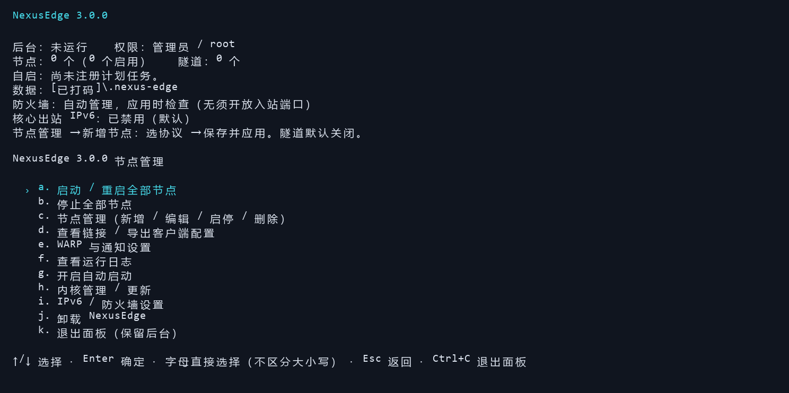
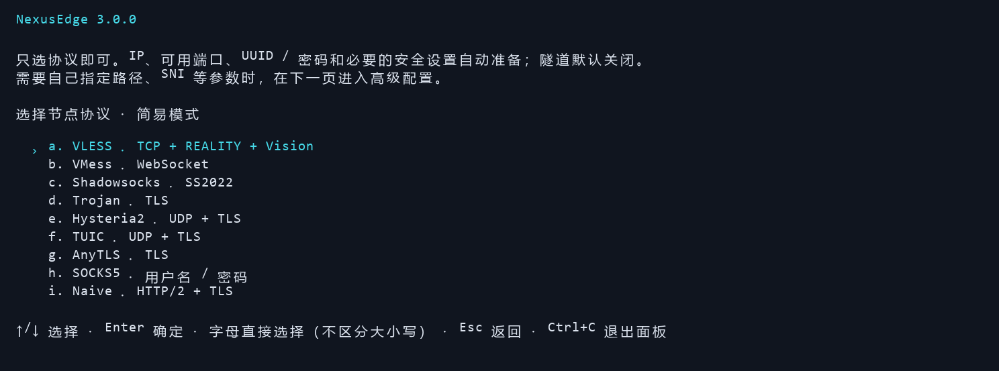
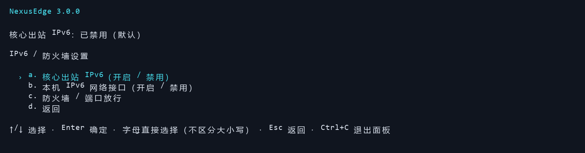

# NexusEdge

**在 Windows 和 Linux 上创建、管理和分享代理节点的终端工具。**

NexusEdge 将 Xray、sing-box 和 Cloudflare Tunnel 的配置与管理集中到一个中文菜单中。选择协议后，程序会准备端口和认证信息；你可以直接保存启动，也可以按需调整传输方式、TLS / REALITY、隧道和网络出口。

[下载最新版](https://github.com/figozhu/nexus-edge/releases/latest) · [反馈问题](https://github.com/figozhu/nexus-edge/issues)



<details>
<summary>查看协议选择与网络设置</summary>





</details>

## 能做什么

- **管理多个节点**：最多 32 个节点，可新增、编辑、复制、启停和删除，各自设置协议、端口与凭据。
- **快速创建节点**：简易模式自动准备常用配置，支持 VLESS、VMess、Shadowsocks 等九种协议。
- **导出客户端配置**：复制节点链接，或导出 Xray / sing-box 客户端 JSON。
- **按需使用隧道**：VLESS / VMess WebSocket 节点可接入 Cloudflare 临时或固定隧道，默认关闭。
- **后台运行与自动启动**：退出面板后保留后台，可设置 Windows 开机任务或 Linux systemd 服务。
- **管理内核与网络**：按需下载和校验核心，检查更新、回退版本，管理本机防火墙端口、IPv6 和 WARP 出口。

NexusEdge 运行在提供节点的服务器或电脑上。连接节点的手机、电脑仍需使用兼容的代理客户端。普通直连节点不需要 Cloudflare 账户或 Tunnel Token；Shadowsocks 和默认 VLESS REALITY 方案也不需要自备域名。

## 下载与运行

从 [Releases](https://github.com/figozhu/nexus-edge/releases/latest) 下载适合系统的文件，放到自己有写权限的目录。独立程序已包含运行时，无需安装 Bun、Node.js 或 npm；首次启动节点时仍需联网下载所需协议核心。

| 平台 | 下载文件 | 运行命令 |
| --- | --- | --- |
| Windows x64 | `nexus-edge-windows-x64.exe` | `.\nexus-edge-windows-x64.exe` |
| Linux x64（glibc） | `nexus-edge-linux-x64` | `chmod +x nexus-edge-linux-x64 && ./nexus-edge-linux-x64` |
| Linux arm64（glibc） | `nexus-edge-linux-arm64` | `chmod +x nexus-edge-linux-arm64 && ./nexus-edge-linux-arm64` |

请在正常的交互式终端中运行。Linux 可用 `uname -m` 查看架构：`x86_64` 选 x64，`aarch64` 选 arm64。目前不提供 macOS、Windows ARM64、32 位或 Alpine / musl 版本。

下载后可用同一版本的 `SHA256SUMS` 核对文件：Windows 使用 `Get-FileHash -Algorithm SHA256 <文件名>`，Linux 使用 `sha256sum <文件名>`。

便携数据保存在程序所在目录的 `.nexus-edge` 中。若已有系统安装，正常启动会打开系统副本；需要单独使用当前便携目录时，在运行命令后加 `--local`。

<details>
<summary>使用 TypeScript 单文件运行</summary>

安装 [Bun](https://bun.com/docs/installation) 1.4.3 或更新版本，下载 `nexus-edge.ts` 后运行：

```bash
bun nexus-edge.ts
```

源码入口不支持直接用 Node.js 执行。完整仓库也提供 Windows 的 `start.cmd` 和 Linux 的 `start.sh`。下文的程序参数同样可用于 `bun nexus-edge.ts`。

</details>

## 创建第一个节点

1. 打开 **节点管理 → 新增节点（简易模式）**，选择协议。
2. 查看摘要中的连接地址、端口和认证信息。需要修改时打开相应分组，否则选择 **保存并应用**。
3. 等待所需核心下载、配置检查和启动完成。需要调整本机防火墙时，程序会请求管理员 / sudo 权限。
4. 进入 **查看链接 / 导出客户端配置**，将链接或 JSON 导入兼容客户端，再实际连接测试。

不确定先选什么，可以从以下两种开始：

- **Shadowsocks**：默认 SS2022，自动生成密码，适合支持 SS2022 的客户端。
- **VLESS**：默认 TCP + REALITY + Vision，自动生成 UUID、密钥与 Short ID。默认握手目标为 `apple.com:443`，可在高级配置中修改。

如果无法获取公网地址，可在摘要中手动填写客户端实际要连接的 IP / 域名。服务器位于路由器或云 NAT 后面时，还需要配置端口映射；云服务器的安全组也需放行对应端口。

**面板显示就绪只说明本机监听、核心或隧道状态正常，不代表公网连接已经验证成功。** 请使用客户端完成一次实际连接。

## 支持的协议

| 协议 | 可选传输 | 安全与认证 |
| --- | --- | --- |
| VLESS | TCP、WebSocket、gRPC、XHTTP | UUID；支持 TLS、REALITY、Vision、ENC，组合受配置校验限制 |
| VMess | TCP、WebSocket、gRPC | UUID；可选 TLS |
| Shadowsocks | TCP + UDP | 经典 AEAD、SS2022 |
| Trojan | TCP、WebSocket、gRPC | 密码 + TLS |
| Hysteria2 | QUIC / UDP | 密码 + TLS；可选 Salamander 混淆 |
| TUIC | QUIC / UDP | UUID、密码 + TLS |
| AnyTLS | TCP | 密码；TLS 或 REALITY |
| SOCKS5 | TCP、UDP ASSOCIATE | 用户名、密码；无附加 TLS |
| NaiveProxy | HTTP/2 | 用户名、密码 + TLS |

VLESS 使用 Xray，其余协议使用 sing-box。程序只准备当前节点需要的核心；启用隧道时才额外准备 cloudflared。

客户端必须支持所选协议及参数。尤其是 XHTTP、ENC、REALITY 和证书指纹，较旧客户端或部分图形客户端可能无法完整导入。SOCKS5 本身不加密传输，应根据网络环境谨慎使用。

### 导出与连接

多数协议可以复制 URI 链接，也可导出完整客户端 JSON。VLESS 导出 Xray 格式，其余导出 sing-box 格式；AnyTLS + REALITY 和 Naive 使用完整 JSON。

若直接使用核心作为客户端，在客户端设备运行对应命令：

```bash
xray run -c client-xray.json
# 或
sing-box run -c client-sing-box.json
```

导出配置默认提供本机 SOCKS 代理 `127.0.0.1:1080`。使用图形客户端时，以该客户端的导入和代理设置为准。

**导出的链接和 JSON 包含可用凭据，请妥善保管，不要公开发布。**

## 日常使用

菜单支持方向键选择、Enter 确认，也可按显示的字母快捷键直接选择。Esc 返回或取消；在编辑摘要中取消会放弃当前草稿。

| 入口 | 用途 |
| --- | --- |
| 节点管理 | 新增、编辑、复制、启停或删除节点 |
| 启动 / 重启全部节点 | 应用已保存的配置并启动节点 |
| 停止全部节点 | 停止后台与核心，自动启动设置保持不变 |
| 查看链接 / 导出客户端配置 | 复制链接、保存 JSON、调整客户端连接地址 |
| 查看运行日志 | 排查核心、隧道和连接问题 |
| 开启 / 关闭自动启动 | 管理开机或登录后的自动运行 |
| 内核管理 / 更新 | 检查官方版本、升级和回退 |
| IPv6 / 防火墙设置 | 管理核心 IPv6、网卡 IPv6 与本机端口放行 |
| 退出面板（保留后台） | 关闭交互界面，节点继续运行 |

简易编辑可选择 **保存并应用**，或 **仅保存，稍后启动**。高级编辑、节点启停和删除后，按提示执行 **启动 / 重启全部节点**。更改服务端参数或更新内核会短暂中断连接；只改客户端连接 IP / 对外端口通常不需要重启核心。

### 地址、端口与证书

- **监听地址 / 端口**：服务器在哪些网卡和端口接收连接。`0.0.0.0` 和 `::` 是监听范围，不能当作客户端服务器地址。
- **客户端连接地址 / 端口**：手机或电脑实际连接的公网 IP、域名及对外端口。存在 NAT 映射时，对外端口可与监听端口不同。
- **SNI / REALITY 目标**：用于 TLS 握手，与客户端连接地址不是同一概念。REALITY 目标必须能从服务器访问，并具备所需 TLS 能力。

TLS 节点支持导入 PEM 证书和私钥，也可生成自签证书。自签证书的信任方式依协议而异：VLESS 使用证书指纹，Naive 的 JSON 内含公开证书；其他 sing-box 协议可能使用跳过 CA 校验的设置，或使用受信任证书严格校验。请核对客户端的证书验证设置。

程序不自动申请或续期 ACME 证书。更换证书后请重新应用配置，必要时重新导出客户端配置。

### Cloudflare 隧道

VLESS / VMess 的 WebSocket 节点可在摘要中打开 **隧道设置**：

- **关闭**：默认方式，客户端直接连接服务器。
- **临时隧道**：启动后获取临时主机名，适合试用；重建后地址可能改变。
- **固定隧道**：填写已在 Cloudflare 配置好的公共主机名和完整 Tunnel Token，适合需要固定地址的场景。

可选择 **仅隧道**，也可保留 **同时直连和隧道**。固定隧道需自行在 Cloudflare 配置公共主机名到本机 HTTP 服务的映射，例如 `127.0.0.1:10086`；实际端口以节点配置为准。

开启隧道可能改变节点的传输与加密方案，请按提示重新导入链接。想保留原有 REALITY 节点时，建议另建一个隧道节点。普通 HTTP 隧道不直接承载 Shadowsocks、Hysteria2 或 TUIC 原生入口。

### WARP 出口

在 **WARP 与通知设置** 中导入 WireGuard `.conf` 或 WARP JSON，再为需要的节点选择 WARP 出口。客户端如何连入节点，与节点通过 Direct 还是 WARP 访问目标，是两项独立设置。

WARP 只作用于选择它的节点，不创建全系统 TUN。启用前需准备有效配置，并确认服务器网络可连接 WARP。

### 防火墙与 IPv6

默认自动管理本机端口，支持 Windows Defender Firewall，以及 Linux 的 UFW、firewalld、iptables / ip6tables。程序按启用节点的监听端口和 TCP / UDP 类型放行；仅隧道节点不需要新增公网入站规则。

本机放行不能代替云安全组、路由器映射或第三方防火墙配置。遇到不支持的防火墙或多套管理器冲突时，可在菜单中改为手动管理。SOCKS5 的 UDP ASSOCIATE 动态端口需按自己的网络方案配置。

**核心出站 IPv6 默认关闭。** 需要双栈时，在 **IPv6 / 防火墙设置 → 核心出站 IPv6** 中开启，并确保操作系统已有可用 IPv6 网络。

“本机 IPv6 网络接口”是另一项独立设置，会影响这台电脑上的其他应用。通过 IPv6 远程管理服务器时，不要随意禁用接口，以免断开连接。

## 后台运行、更新与卸载

### 自动启动

退出面板不会停止已启动的后台。需要长期运行时，可从主菜单启用自动启动：

- **Windows**：系统开机模式无需登录，安装到系统数据目录下的 `NexusEdge`，通常为 `C:\ProgramData\NexusEdge`；也可选择当前用户登录后启动。
- **Linux**：需要 systemd，安装到 `/opt/nexus-edge`，服务名为 `nexus-edge.service`。

系统安装需要管理员 / root 权限。关闭自动启动不会停止当前后台；若要暂停服务，还需选择 **停止全部节点**。关机、休眠或断网期间节点无法提供服务。

### 更新核心

进入 **内核管理 / 更新 → 检查更新（稳定版，推荐）**，查看版本变化后确认更新。程序校验下载文件并用现有配置预检，通过后才切换；也可选择 **回退上次内核版本**。

更新会保留节点配置，但可能短暂重启后台、断开连接，临时隧道地址也可能变化。更新后请检查状态并实际连接测试。打开面板或普通启动不会自动追随新版本。

### 更新 NexusEdge

更新前备份 `.nexus-edge/config.json`。

- **便携版**：停止后台并退出旧程序，替换同目录的可执行文件，保留 `.nexus-edge` 数据目录。
- **已有系统安装**：运行新下载的同格式程序，按提示升级系统副本。Windows 下需先停止后台并关闭所有系统副本面板，避免程序文件被占用。
- **从脚本版切换到独立程序**：先备份配置，用旧版卸载并选择保留配置，再将配置复制到新版目录的 `.nexus-edge/config.json`。使用 `--local` 验证节点后重新启用自启；不要直接覆盖另一格式的系统安装。

跨机器或跨平台迁移时，只迁移节点配置等可移植数据，在目标机器重新准备核心和防火墙规则。不要复制旧运行状态、锁文件或防火墙归属记录。

### 卸载

主菜单选择 **卸载 NexusEdge**，或在程序运行命令后加 `--uninstall`。核对显示的安装目录，再选择保留或删除配置。

卸载会停止后台、注销自启，并清理本安装创建的防火墙规则。默认保留节点配置和配置备份；选择删除配置需再次确认，删除后不可恢复。便携下载文件、无关文件和全局 Bun 不会被一并删除。

卸载默认优先处理已激活的系统安装。只处理当前便携目录时加 `--local`；仅关闭自动启动不等于卸载。

## 常见问题

**节点已就绪，但客户端连不上？**

先确认导出地址和对外端口正确，再检查云安全组、NAT 映射及本机防火墙。Hysteria2、TUIC 使用 UDP；客户端也必须支持所选协议和参数。查看运行日志中的具体错误，不要只依赖“就绪”状态。

**无法下载或更新核心？**

确认服务器能访问对应项目的 GitHub Releases。下载校验或配置预检失败时，按提示排查，不要跳过校验；更新失败不代表旧版本已被替换。

**Linux 提示权限不足或无法执行？**

先执行 `chmod +x <文件名>`，再核对 CPU 架构和系统是否使用 glibc。配置无法保存时，将程序放到有写权限的目录。

**配置和日志在哪里？**

便携版使用程序目录下的 `.nexus-edge`；系统安装使用对应系统目录中的数据。常用文件有：

- `config.json`：节点及认证配置，备份时优先保留。
- `config.json.bak`：保存前的有效配置。
- `daemon.log`：运行日志。
- `node-link.txt`：当前就绪节点的链接。
- `exports/`：导出的客户端 JSON。

配置、备份和导出文件都可能含密码、Token 或私钥。公开截图、日志或提交问题时，还应遮盖本机完整路径（包括临时目录）、用户名、主机名和真实服务器地址；路径可只保留 `.nexus-edge/config.json` 这类通用部分。请附上操作系统、NexusEdge 版本、复现步骤和已脱敏的相关错误信息。

## 许可证

NexusEdge 采用 [MIT License](LICENSE)。第三方组件使用各自许可证，详见 [THIRD_PARTY.md](THIRD_PARTY.md)。
